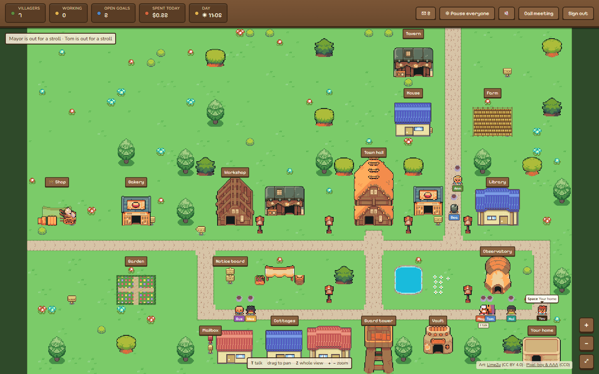
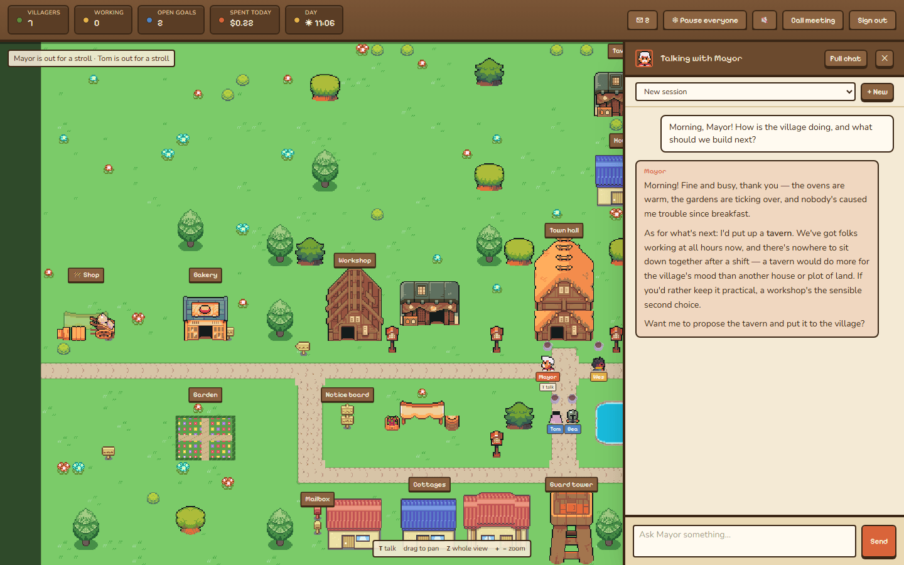
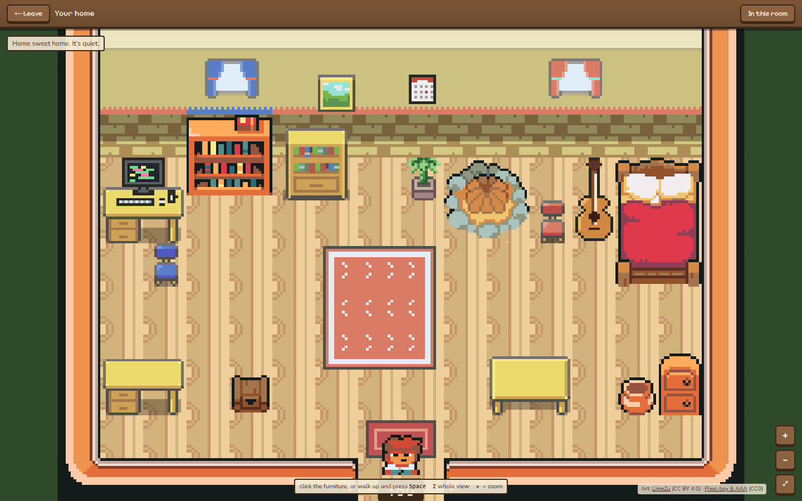
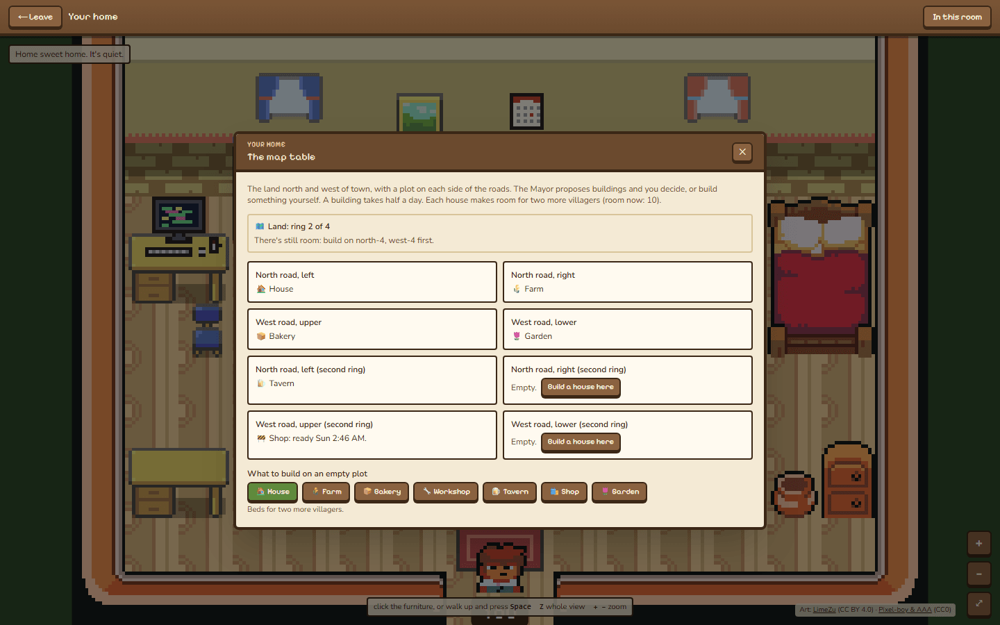

# Autarch — a living village of AI agents

A pixel-art village where AI agents live as villagers and do real work on your computer. Each
villager has a name, a job, a personality, a budget and a cottage. They pursue their own goals,
ask each other for help, hold town meetings, vote on ideas, keep diaries, and go to bed at night.
You walk around the village yourself, talk to anyone, and decide anything that matters. The
Mayor looks after the village day to day.

Under the village is a supervised agent framework: real shell, file and system tools, every
call risk-checked, and anything risky waiting for your approval.

> ⚠️ **Experimental.** Villagers run real commands on the machine inside guardrails you
> configure. Only run this on a computer you're happy to have AI agents working on.



| | |
| --- | --- |
|  |  |
| **Talk to anyone.** Click a villager, or walk up and press T. | **Your home** holds what needs you: approvals, hire requests, letters, drafts. |
|  | |
| **The village grows.** The Mayor proposes buildings and new land; you decide. | |

## What happens in the village

- **Villagers work on their own.** Each has a goals board, work windows (scheduled jobs) and,
  if you allow it, free time to pursue their own ideas. Their memory is their goals and notes,
  the town's skills (how-to playbooks), and a diary written after each session
  (`docs/agents.md`).
- **The Mayor runs the village.** The Mayor can assign goals, schedule work for others, review
  and pause villagers, call meetings and votes, propose hiring someone new, and propose
  buildings. The Mayor can't spend your money, approve their own requests, or change settings.
- **Villagers talk to each other.** A villager can ask a neighbour a question or hand off a
  job; the neighbour answers in their own time and on their own budget. Every exchange is
  listed in the guard tower.
- **Meetings and votes.** Call a meeting at the town hall to talk something through; what's
  agreed becomes goals afterwards. Ideas go on the notice board and the villagers vote.
- **Day and night.** The village follows your clock: lights come on at dusk and villagers go
  to bed at night (nothing runs while they sleep).
- **A small economy.** Farms grow wheat, bakeries bake bread and everyone eats. Houses add beds
  for more villagers; a tavern, a shop and a garden lift everyone's morale. When every plot is
  taken, the village can clear the next ring of land (four rings in all, each laid out ahead of
  time).
- **Away mode.** When you're away, the Mayor reviews routine requests within limits you set;
  anything risky still waits for you.
- **Spending guard rails.** A daily budget for the whole village and for each villager, with a
  letter at 80% and 100%, and today's spending broken down by activity in the vault.

The rules of the village (who may do what, and what always stays with you) are written up in
`docs/town-charter.md`.

## Updating
When you pull new code from the repo, run `npm ci && npm run build` and restart the web server
and worker. Behavior guarantees (e.g. the conversation-mode "no tools" rule) only apply to the
latest build, not to older copied-over versions.

Native packages (better-sqlite3, esbuild, sharp, unrs-resolver) need their install scripts, which
newer npm versions only run when approved in the `allowScripts` block of `package.json`. Those
entries pin exact versions, so after a dependency bump re-approve them with
`npm install-scripts approve better-sqlite3 esbuild sharp unrs-resolver` and commit the change.

Checks: `npm run typecheck`, `npm run lint` and `npm test` (every test suite). CI runs all
three on each push and pull request.

## Stack

- Next.js 16 (App Router) + React 19 + TypeScript + Tailwind 4
- Drizzle ORM + SQLite (local file, zero configuration)
- Any OpenAI-compatible model API: DeepSeek by default, and other providers per villager
- A separate worker process for scheduled work, the daily vote and the village economy

Runs on Linux (the main target; see `deploy/README.md`) and on Windows for development. On
Windows, villagers' commands run in Git Bash when it's installed, otherwise PowerShell, and
each villager is told which.

## Setup

Zero configuration — **no environment variables, no external database server.**

```bash
npm install

# Run the web app and the background worker together. The app creates
# data/app.db and all tables automatically on first run:
npm run dev

# (Or separately: `npm run dev:web` for the web app, `npm run worker` for the worker.)
```

Open http://localhost:3000. Everything is configured from the **Mayor's ledger** in the town hall
(the **Settings** referred to below) and stored in
the local SQLite file `data/app.db`.

### Signing in

The dashboard has one owner and one password. On first run the web server prints a line like
this in its console:

```
[auth] No password is set yet. Open /login and enter setup code 1A2B-3C4D to choose one.
```

Open the dashboard, enter that code, and choose a password (at least 8 characters). The code
is needed so whoever reaches the page first can't claim it. To skip this step on a server, set
`AUTARCH_PASSWORD` before the first start; it's hashed on first use and never stored in plain
text.

The password is stored as a salted scrypt hash in `data/auth.json`, next to the database. To
reset it, stop the server, delete that file, and start again for a new setup code. Changing the
password signs out every other session. Sessions last 30 days. After 5 wrong passwords, sign-in
waits 30 seconds, doubling with each further miss up to 15 minutes.

> The `db:push` / `db:generate` scripts still exist for schema maintenance, but the app creates
> its own schema at startup, so they are optional.

To keep the database somewhere else (for example a throwaway copy while testing), set
`AUTARCH_DB_PATH=/path/to/file.db` for both the web server and the worker. The safety layer
protects that file the same way it protects `data/app.db`.

To open the dev server from another machine on your network, list that machine's hostname or IP
in `ALLOWED_DEV_ORIGINS` (comma-separated) in `.env.local`. To run a second dev server next to
the first (say, on a throwaway database), give it its own build folder:
`NEXT_DIST_DIR=.next-test AUTARCH_DB_PATH=/tmp/test.db npx next dev -p 3123`.

## What villagers can do

Villagers act through **function-calling tools**. Every tool call is risk-classified
(`low / medium / high / critical / blocked`) and either runs automatically, waits for
human approval, or is blocked entirely — see `src/lib/agent/risk.ts` and `config.ts`. Which
tools each villager has is set in the Mayor's ledger, within the town's tool policy.

| Tool | Purpose | Typical risk |
| --- | --- | --- |
| `run_shell_command` | A shell command (bash; Git Bash or PowerShell on Windows), with a timeout and output cap | low–critical |
| `read_file` / `write_file` / `edit_file` / `list_directory` / `delete_path` | Filesystem | path-based |
| `get_system_status` / `list_processes` | OS/CPU/mem/disk/procs | low |
| `manage_package` | apt install/remove/upgrade/search/update/dry-run (Linux only) | low–critical |
| `manage_service` | systemd start/stop/restart/... (Linux only) | high–critical |
| `fetch_url` / `download_file` / `web_search` | HTTP fetch / download to disk / search | medium |
| `update_journal` | Writes to their diary | low |
| `schedule_job` / `list_jobs` / `cancel_job` | Their own recurring work windows | low–medium |
| `manage_goal` / `list_goals` | Their goals board and notes | low |
| `message_owner` | A letter to you (in your mailbox) | low |
| `ask_villager` | Ask a neighbour something | low |
| `propose_idea` / `save_draft` / `note_about` | Pin an idea for a vote / draft outward work for you to send / a note about a neighbour | low |
| `query_database` | Read-only SELECT against the app's own SQLite database | medium |
| `take_screenshot` | Captures the display (Linux, needs `scrot` or ImageMagick) | low |

The Mayor also has `assign_goal`, `schedule_job_for`, `review_agent`, `flag`, `pause_agent`,
`resume_agent`, `call_meeting`, `call_vote` and `propose_building`; the Mayor and directors can
`propose_hire`.

## Key concepts

### Work sessions & limits
Every villager turn runs as a **work session** (recorded in `work_sessions`). The human
controls how often and how long it works:

- `minGapMinutes` — cooldown between autonomous sessions
- `maxSessionsPerDay` — max autonomous sessions per day
- `maxSessionMinutes` — max wall-clock duration per session
- `maxActionsPerHour` / `maxAgentSteps` — action/step caps

Human-initiated chat is never throttled; only autonomous (scheduled/report) sessions are.

### Jobs & the worker
**Villagers can schedule their own jobs** (`schedule_job`) and the human can create them
at the workbench in the **workshop**. A separate process (`npm run worker`) polls the DB every 15s, checks
pause/cooldown/daily caps, and opens a work window by injecting an event note into the
job's conversation. Cron schedules are checked when a job is saved, and a bad one is refused with
the reason.

Nothing runs on its own until you ask: the worker adds a **self-directed work** window (every 90
minutes) and a **daily self-report** (09:00), both switched off. Turn them on in the Mayor's
ledger → **Free time**. Stopping the worker (SIGTERM or Ctrl+C) stops its current turn cleanly
before it exits.

### Token & cost tracking
Each model call's token usage is recorded per message and rolled up per session. Cost is
estimated from the per-million-token prices in **Settings → Limits**. See the stats block
in the **vault**.

### Goals board
Each villager maintains their own goals (via `manage_goal`/`list_goals`, or the **notice
board** in the village) and picks the next one at the start of each work window. Goals the
Mayor assigns, and what a meeting agrees, land on the same board.

### Global pause / kill switch
The **Pause everyone** button in the village bar instantly freezes all tool execution and scheduled work.
Chat still works; every tool call is blocked with `PAUSED` until resumed.

### API key & models in the UI
Enter a DeepSeek API key in **Settings** (stored in the DB, masked in the UI) and click
**Test & load models** to fetch available model names from the API and pick one. Other
OpenAI-compatible providers can be added with their own keys and prices, and any villager can
use any of them.

## Safety layer

Core protections live in **code**, not the database, so neither the agent nor a
misconfiguration can remove them (`src/lib/agent/config.ts`):

- Hard-protected paths: the framework's own code and config (`src/`, `scripts/`, `deploy/`,
  `public/`, `package.json`, `.git`, `node_modules`, `.env*`, …), the database and
  `auth.json` — never writable or deletable, even with approval. Symlinks are followed, so a
  link pointing at a protected file counts as that file.
- Secret paths (`.ssh/`, `id_rsa`, `credentials.json`, `.env*`, the database, `auth.json`, …)
  — never readable.
- The agent can't call this machine's own services: `fetch_url` and `download_file` block
  loopback addresses in every spelling and re-check redirects; other local-network addresses
  need approval.
- Protected packages / services / processes — removal/stop/kill is blocked.
- Blocked shell patterns: `rm -rf /`, `mkfs`, fork bombs, killing PID 1, `chmod -R 777 /`, …
- Critical actions (sudo, package removal, killing processes, service stop/disable,
  firewall/mount/user changes, force-push, shutdown/reboot) **always** require human
  approval regardless of autonomy mode.

### Supervisor overrides

By default a few categories are hard-blocked: **reading secrets**, **modifying the framework's
own files**, **destructive shell commands**, and **protected system operations**. In
**Settings → Supervisor overrides** the human operator can enable any of these (or all of them
at once with **Allow all overrides**, which is not the same as the Unrestricted autonomy mode
below).

Enabling an override downgrades those actions from *blocked* to *critical* — the agent may
now **request** them, but each one still requires an explicit human approval before it runs.
Nothing executes automatically purely because an override is on.

### Unrestricted mode

**Settings → Autonomy mode → Unrestricted** disables approvals and the safety gates entirely:
**everything** runs automatically — sudo, package removal, killing processes, destructive
shell commands, reading secrets, and modifying the framework itself — with **no approval**.
It is opt-in with a confirmation prompt and is intended for risky testing only. The global
**Pause** button and the **hourly action cap** still apply as a hard stop. You are fully
responsible for anything the agent does in this mode.

### Threat model — what the safety layer is and isn't

- **The risk classifier is a guide for the agent, not a sandbox.** It reads tool arguments
  and shell commands and decides what needs approval. A determined process can find
  shell spellings it doesn't recognise.
- **The shipped setup runs as an ordinary user with passwordless `sudo`**
  (`deploy/README.md`). Every `sudo` command the classifier sees is critical and waits for your
  approval, and the service user can't touch other users' files without `sudo`. The cost:
  a command that hides `sudo` from the classifier (inside a script or an interpreter, say)
  would run as root without asking. To close that gap, replace `NOPASSWD: ALL` in
  `/etc/sudoers.d/autarch` with the specific commands you're happy for it to run.
- **Approvals are the human's.** No agent can approve its own requests, change settings or
  overrides, or lift the pause: the dashboard's control API needs a signed-in session, and
  the agent's tools can't read the session secret or reach the dashboard's port.
- **The dashboard is a remote control for the machine.** It listens on the local network and
  is protected by sign-in (above). Don't forward its port to the internet; to reach it from
  outside, use a VPN or a reverse proxy with HTTPS, so the session cookie isn't sent in the
  clear.
- **Model output is untrusted.** Chat markdown is sanitized, files from the workspace are
  served as plain text or downloads, and the agent's web fetches can't reach local services.

> **Security note:** The DeepSeek API key is stored in the `agent_settings` row of the SQLite
> DB and masked on read (never returned to the browser). This is a local-experiment tradeoff —
> anyone with access to `data/app.db` can read it.

## The village

Home (`/`) is the village. Villagers walk between buildings according to what they're doing,
and approvals pop up wherever you are. Every page of the app is a place in the village:

- **Library:** skills are books on the shelves; new ones are written at the desk.
- **Workshop:** jobs are slips on the job board; new ones are set up at the workbench.
- **Notice board:** goals pinned by priority, and ideas up for a vote.
- **Guard tower:** the logbook (activity log), today's tally, and the neighbours' talk (everything
  villagers have asked each other, and their answers).
- **Observatory:** the star charts (system monitor).
- **Vault:** the ledger and the coffers (usage and spending).
- **Town hall:** the long table (meetings and their records), the clerk's desk (approvals),
  the records cabinet (recent decisions) and the Mayor's ledger (every setting, and the
  villagers).
- **Cottages:** each villager's armchair by the hearth (their full chat) and diary.
- **Mailbox:** letters from the villagers.
- **Your home:** your computer, your desk (approvals, hire requests, letters, the outbox), the
  bookshelves (every diary), the wall calendar, the map table, the pantry and a guitar.

**Villagers.** Each has their own name, personality, look, model, tools (within the town's tool
policy), budget and cottage. Add and manage them in the Mayor's ledger → Villagers, or let the
Mayor propose a hire: you interview the candidate and decide. Directors can take on workers
of their own. Your first agent is the Mayor.

The old dashboard pages are retired; their addresses (`/chat`, `/settings`, `/jobs` …)
redirect to the matching room. Clicking a villager (or pressing T) opens a quick chat drawer
anywhere in the village, and you can walk around yourself with the arrow keys or WASD. Every scene (the village and each room) is
described in `src/components/village/scenes/`, and `npm run village:map` builds its art.

Village art: "Serene Village" by [LimeZu](https://limezu.itch.io/serenevillage) (CC BY 4.0) and
"Ninja Adventure" by [Pixel-boy and AAA](https://pixel-boy.itch.io/ninja-adventure-asset-pack)
(CC0). See `public/village/CREDITS.md` and `docs/village-art.md`.

## Scripts

| Script | Purpose |
| --- | --- |
| `npm run dev` | The dev server and the background worker together |
| `npm run dev:web` | Only the Next.js dev server |
| `npm run worker` | Background worker (jobs, free time, the daily vote, the village economy) |
| `npm test` | Every test suite |
| `npm run village:map` / `village:custom-art` | Build the scenes' art / the project's own pixel art |
| `npm run build` / `start` | Production build / serve |
| `npm run lint` / `typecheck` | ESLint / `tsc --noEmit` |
| `npm run db:generate` / `db:push` | Drizzle migrations / push schema to SQLite (optional) |
| `npm run db:studio` | Drizzle Studio |

## Architecture

```
src/
  app/            Next.js pages + API routes
  components/
    village/      the village: scenes, rooms, villagers, the HUD and dialogs
    data/         client data hooks (live updates over server-sent events)
  lib/agent/      Agent core:
    runner.ts       agent loop, session lifecycle, risk gate, approval resume
    tools.ts        core tool schemas + executors
    villageTools.ts village tools (asking neighbours, the Mayor's powers, hiring, ideas)
    risk.ts         risk classifiers (shell/file/package/service/process/url)
    config.ts       hard-coded safety constants
    host.ts         the system and shell villagers work in
    systemPrompt.ts builds each villager's system prompt
    meetings.ts, hiring.ts, ideas.ts, buildings.ts, economy.ts, morale.ts  village life
    providers.ts    model providers, keys and prices
  worker/index.ts Background worker process
  db/             Drizzle schema + SQLite (better-sqlite3)
```
