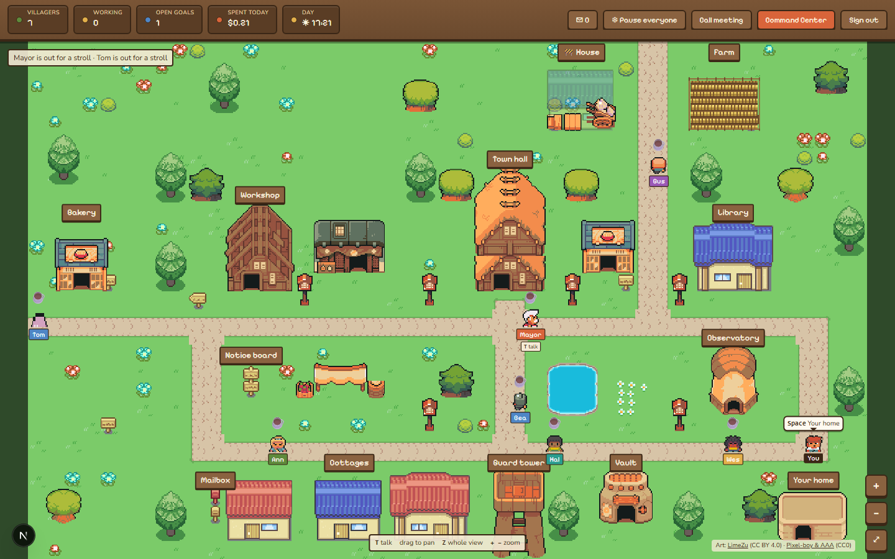

# Autarch — Autonomous Agent Control Framework

A general-purpose framework that gives an autonomous AI agent **controlled root-level access to a
real computer system**, wrapped in a multi-layer safety/guardrail system and supervised from a
web dashboard.

> ⚠️ **Experimental.** The agent runs with real shell, file, and system access inside
> guardrails you configure. It can install packages, manage services, schedule its own
> work windows, and pursue its own goals. Only run this on a machine you are OK with an
> AI poking around.



## Updating
When you pull new code from the repo, run `npm ci && npm run build` and restart the web server
and worker. Behavior guarantees (e.g. the conversation-mode "no tools" rule) only apply to the
latest build, not to older copied-over versions.

Native packages (better-sqlite3, esbuild, sharp, unrs-resolver) need their install scripts, which
newer npm versions only run when approved in the `allowScripts` block of `package.json`. Those
entries pin exact versions, so after a dependency bump re-approve them with
`npm install-scripts approve better-sqlite3 esbuild sharp unrs-resolver` and commit the change.

Checks: `npm run typecheck`, `npm run lint` and `npm test` (every test suite). CI runs all
three on each push and pull request.

## Stack

- Next.js 16 (App Router) + React 19 + TypeScript + Tailwind 4
- Drizzle ORM + SQLite (local file, zero configuration)
- OpenAI SDK pointed at the DeepSeek API

## Setup

Zero configuration — **no environment variables, no external database server.**

```bash
npm install

# 1. Run the web app. It creates data/app.db and all tables automatically on first run:
npm run dev

# 2. In a second terminal, run the background scheduler:
npm run worker
```

Open http://localhost:3000. Everything is configured from the **Settings** tab and stored in
the local SQLite file `data/app.db`.

### Signing in

The dashboard has one owner and one password. On first run the web server prints a line like
this in its console:

```
[auth] No password is set yet. Open /login and enter setup code 1A2B-3C4D to choose one.
```

Open the dashboard, enter that code, and choose a password (at least 8 characters). The code
is needed so whoever reaches the page first can't claim it. To skip this step on a server, set
`AUTARCH_PASSWORD` before the first start; it's hashed on first use and never stored in plain
text.

The password is stored as a salted scrypt hash in `data/auth.json`, next to the database. To
reset it, stop the server, delete that file, and start again for a new setup code. Changing the
password signs out every other session. Sessions last 30 days. After 5 wrong passwords, sign-in
waits 30 seconds, doubling with each further miss up to 15 minutes.

> The `db:push` / `db:generate` scripts still exist for schema maintenance, but the app creates
> its own schema at startup, so they are optional.

To keep the database somewhere else (for example a throwaway copy while testing), set
`AUTARCH_DB_PATH=/path/to/file.db` for both the web server and the worker. The safety layer
protects that file the same way it protects `data/app.db`.

To open the dev server from another machine on your network, list that machine's hostname or IP
in `ALLOWED_DEV_ORIGINS` (comma-separated) in `.env.local`. To run a second dev server next to
the first (say, on a throwaway database), give it its own build folder:
`NEXT_DIST_DIR=.next-test AUTARCH_DB_PATH=/tmp/test.db npx next dev -p 3123`.

## What the agent can do

The agent acts through **function-calling tools**. Every tool call is risk-classified
(`low / medium / high / critical / blocked`) and either runs automatically, waits for
human approval, or is blocked entirely — see `src/lib/agent/risk.ts` and `config.ts`.

| Tool | Purpose | Typical risk |
| --- | --- | --- |
| `run_shell_command` | Arbitrary bash (timeout + output cap) | low–critical |
| `read_file` / `write_file` / `edit_file` / `list_directory` / `delete_path` | Filesystem | path-based |
| `get_system_status` / `list_processes` | OS/CPU/mem/disk/procs | low |
| `manage_package` | apt install/remove/upgrade/**search**/**update**/**dry-run** | low–critical |
| `manage_service` | systemd start/stop/restart/... | high–critical |
| `fetch_url` / `download_file` | HTTP fetch / download to disk | medium |
| `update_journal` | Writes to its persistent journal | low |
| `schedule_job` / `list_jobs` / `cancel_job` | Creates/manages its own recurring work windows | low–medium |
| `manage_goal` / `list_goals` | Maintains its own goals board | low |
| `notify_human` | Raises a dashboard notification for the human | low |
| `query_database` | Read-only SELECT against the app's own SQLite database | medium |
| `take_screenshot` | Captures the display (needs `scrot` or ImageMagick) | low |

## Key concepts

### Work sessions & limits
Every agent turn runs as a **work session** (recorded in `work_sessions`). The human
controls how often and how long it works:

- `minGapMinutes` — cooldown between autonomous sessions
- `maxSessionsPerDay` — max autonomous sessions per day
- `maxSessionMinutes` — max wall-clock duration per session
- `maxActionsPerHour` / `maxAgentSteps` — action/step caps

Human-initiated chat is never throttled; only autonomous (scheduled/report) sessions are.

### Jobs & the worker
The **agent can schedule its own jobs** (`schedule_job`) and the human can create them
in the **Jobs** tab. A separate process (`npm run worker`) polls the DB every 15s, checks
pause/cooldown/daily caps, and opens a work window by injecting an event note into the
job's conversation. Cron schedules are checked when a job is saved, and a bad one is refused with
the reason.

Nothing runs on its own until you ask: the worker adds a **self-directed work** window (every 90
minutes) and a **daily self-report** (09:00), both switched off. Turn them on in the Mayor's
ledger → **Free time**. Stopping the worker (SIGTERM or Ctrl+C) stops its current turn cleanly
before it exits.

### Token & cost tracking
Each model call's token usage is recorded per message and rolled up per session. Cost is
estimated from the per-million-token prices in **Settings → Limits**. See the stats block
on the **Activity** page.

### Goals board
The agent maintains its own goals (via `manage_goal`/`list_goals` or the **Goals** tab)
and is instructed to pick its next in-progress/backlog goal at the start of each work window.

### Global pause / kill switch
The **⏸ Pause** button (sidebar) instantly freezes all tool execution and scheduled work.
Chat still works; every tool call is blocked with `PAUSED` until resumed.

### API key & models in the UI
Enter a DeepSeek API key in **Settings** (stored in the DB, masked in the UI) and click
**Test & load models** to fetch available model names from the API and pick one.

## Safety layer

Core protections live in **code**, not the database, so neither the agent nor a
misconfiguration can remove them (`src/lib/agent/config.ts`):

- Hard-protected paths: the framework's own code and config (`src/`, `scripts/`, `deploy/`,
  `public/`, `package.json`, `.git`, `node_modules`, `.env*`, …), the database and
  `auth.json` — never writable or deletable, even with approval. Symlinks are followed, so a
  link pointing at a protected file counts as that file.
- Secret paths (`.ssh/`, `id_rsa`, `credentials.json`, `.env*`, the database, `auth.json`, …)
  — never readable.
- The agent can't call this machine's own services: `fetch_url` and `download_file` block
  loopback addresses in every spelling and re-check redirects; other local-network addresses
  need approval.
- Protected packages / services / processes — removal/stop/kill is blocked.
- Blocked shell patterns: `rm -rf /`, `mkfs`, fork bombs, killing PID 1, `chmod -R 777 /`, …
- Critical actions (sudo, package removal, killing processes, service stop/disable,
  firewall/mount/user changes, force-push, shutdown/reboot) **always** require human
  approval regardless of autonomy mode.

### Supervisor overrides

By default a few categories are hard-blocked: **reading secrets**, **modifying the framework's
own files**, **destructive shell commands**, and **protected system operations**. In
**Settings → Supervisor overrides** the human operator can enable any of these (or flip the
master **Unrestricted mode**).

Enabling an override downgrades those actions from *blocked* to *critical* — the agent may
now **request** them, but each one still requires an explicit human approval before it runs.
Nothing executes automatically purely because an override is on.

### Unrestricted mode

**Settings → Autonomy mode → Unrestricted** disables approvals and the safety gates entirely:
**everything** runs automatically — sudo, package removal, killing processes, destructive
shell commands, reading secrets, and modifying the framework itself — with **no approval**.
It is opt-in with a confirmation prompt and is intended for risky testing only. The global
**Pause** button and the **hourly action cap** still apply as a hard stop. You are fully
responsible for anything the agent does in this mode.

### Threat model — what the safety layer is and isn't

- **The risk classifier is a guide for the agent, not a sandbox.** It reads tool arguments
  and shell commands and decides what needs approval. A determined process can find
  shell spellings it doesn't recognise.
- **The shipped setup runs as an ordinary user with passwordless `sudo`**
  (`deploy/README.md`). Every `sudo` command the classifier sees is critical and waits for your
  approval, and the service user can't touch other users' files without `sudo`. The cost:
  a command that hides `sudo` from the classifier (inside a script or an interpreter, say)
  would run as root without asking. To close that gap, replace `NOPASSWD: ALL` in
  `/etc/sudoers.d/autarch` with the specific commands you're happy for it to run.
- **Approvals are the human's.** No agent can approve its own requests, change settings or
  overrides, or lift the pause: the dashboard's control API needs a signed-in session, and
  the agent's tools can't read the session secret or reach the dashboard's port.
- **The dashboard is a remote control for the machine.** It listens on the local network and
  is protected by sign-in (above). Don't forward its port to the internet; to reach it from
  outside, use a VPN or a reverse proxy with HTTPS, so the session cookie isn't sent in the
  clear.
- **Model output is untrusted.** Chat markdown is sanitized, files from the workspace are
  served as plain text or downloads, and the agent's web fetches can't reach local services.

> **Security note:** The DeepSeek API key is stored in the `agent_settings` row of the SQLite
> DB and masked on read (never returned to the browser). This is a local-experiment tradeoff —
> anyone with access to `data/app.db` can read it.

## The village

Home (`/`) is a small pixel-art town where the agent lives as a villager, walking between
buildings according to what it's doing, with approvals popping up wherever you are. Every
place works in-world, with the same features as its classic Command Center page:

- **Library:** skills are books on the shelves; new ones are written at the desk.
- **Workshop:** jobs are slips on the job board; new ones are set up at the workbench.
- **Notice board:** goals pinned by priority, opened right in the village.
- **Guard tower:** the logbook (activity log) and today's tally.
- **Observatory:** the star charts (system monitor).
- **Vault:** the ledger and the coffers (usage and spending).
- **Town hall:** the clerk's desk (approvals), the records cabinet (recent decisions) and the
  Mayor's ledger (every setting).
- **Cottage:** the armchair by the hearth (the full chat) and the diary (the journal).
- **Mailbox:** the agent's notifications.

**Villagers.** The village can have several agents. Each has their own name, personality, look,
model, tools (within the town's tool policy), budget and cottage, and goes about their own work.
Add and manage them in the Mayor's ledger → Villagers. Your original agent is the Mayor.

The classic pages are still there: **Command Center** in the village bar opens them (the chat is
at `/chat`). Clicking the villager (or pressing T) opens a quick chat drawer anywhere in the
village. Every scene (the village and each room) is
described in `src/components/village/scenes/`, and `npm run village:map` builds its art.

Village art: "Serene Village" by [LimeZu](https://limezu.itch.io/serenevillage) (CC BY 4.0) and
"Ninja Adventure" by [Pixel-boy and AAA](https://pixel-boy.itch.io/ninja-adventure-asset-pack)
(CC0). See `public/village/CREDITS.md` and `docs/village-art.md`.

## Scripts

| Script | Purpose |
| --- | --- |
| `npm run dev` | Next.js dev server |
| `npm run worker` | Background scheduler (jobs / daily report) |
| `npm run build` / `start` | Production build / serve |
| `npm run lint` / `typecheck` | ESLint / `tsc --noEmit` |
| `npm run db:generate` / `db:push` | Drizzle migrations / push schema to SQLite (optional) |
| `npm run db:studio` | Drizzle Studio |

## Architecture

```
src/
  app/            Next.js pages + API routes
  components/     React views (Chat, Journal, Jobs, Goals, Approvals, Activity, Monitor, Settings)
  lib/agent/      Agent core:
    runner.ts       agent loop, session lifecycle, risk gate, approval resume
    tools.ts        tool schemas + executors
    risk.ts         risk classifiers (shell/file/package/service/process/url)
    config.ts       hard-coded safety constants
    systemPrompt.ts builds the agent's system prompt (journal, jobs, goals, limits)
    settingsStore.ts single-row settings store
    deepseekClient.ts DeepSeek client + /models helper
  worker/index.ts Standalone scheduler process
  db/             Drizzle schema + SQLite (better-sqlite3)
```
